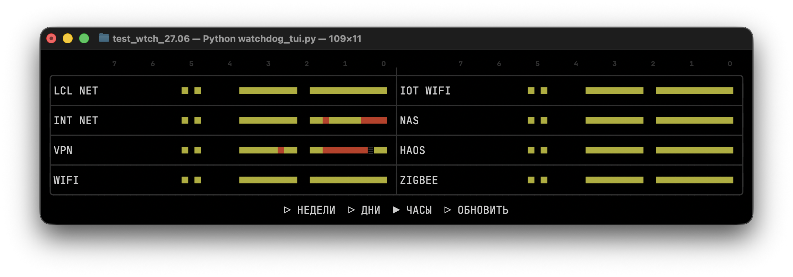

# Watchdog TUI

Консольный TUI-watchdog для домашней инфраструктуры. Интерфейс рисуется через
`curses`, история статусов хранится в SQLite, проверки запускаются по порядку и
пишут худший статус в текущий 10-минутный интервал.



Эта ветка `linux` рассчитана на Raspberry Pi. Для Mac используется отдельная
ветка `mac`.

## Быстрая установка на Raspberry Pi

Сначала подготовь SSH-доступ к приватной GitHub-репе. На малинке под тем
пользователем, который будет делать `git pull`, сгенерируй ключ:

```bash
ssh-keygen -t ed25519 -C "watchdog-pi"
```

Можно оставить путь по умолчанию `~/.ssh/id_ed25519` и пустой passphrase.
Показать public key:

```bash
cat ~/.ssh/id_ed25519.pub
```

Добавь этот public key в GitHub: репозиторий `watchdog-tui` -> `Settings` ->
`Deploy keys` -> `Add deploy key`. Для малинки достаточно read-only ключа, то
есть `Allow write access` можно не включать.

Проверить доступ:

```bash
ssh -T git@github.com
```

GitHub может ответить, что shell access не предоставляется. Это нормально,
главное, чтобы не было `Permission denied (publickey)`.

После этого загрузи репозиторий на малинку. Пользователь может быть любым,
главное запускать setup-скрипт из клонированной папки:

```bash
cd "$HOME"
git clone -b linux git@github.com:tri6odin/watchdog-tui.git
cd watchdog-tui
```

Потом запусти системную подготовку хоста. Этот скрипт ставит пакеты, `kmscon`,
шрифт, настраивает `tty1`, wrapper для автозапуска и интерактивно создает
`watchdog.conf`:

```bash
sudo scripts/configure_raspberry_pi_host.sh
```

Скрипт спросит адреса, таймауты и секреты: Home Assistant token, NAS SMB
учетку, имена Wi-Fi сетей (SSID) и Wi-Fi пароли. Секреты вводятся без эха в
терминал. Touch-настройки не спрашиваются: в конфиг записываются текущие
дефолты `enabled = true`, `event_device = auto`, `swipe_min_dx = 1200`,
`swipe_max_dt_sec = 2.2`, `swipe_horizontal_ratio = 1.1`.

При желании проверь созданный конфиг:

```bash
sudo nano watchdog.conf
```

Проверь один прогон без TUI:

```bash
sudo python3 watchdog_tui.py --once
```

Если проверки выглядят нормально, запускай TUI на `tty1`:

```bash
sudo systemctl restart kmsconvt@tty1
```

Для обновления кода на малинке:

```bash
cd "$HOME/watchdog-tui"
git pull origin linux
sudo systemctl restart kmsconvt@tty1
```

## Что делает host-setup скрипт

Скрипт [scripts/configure_raspberry_pi_host.sh](scripts/configure_raspberry_pi_host.sh)
рассчитан на уже клонированную репу. Он создает `watchdog.conf`
интерактивно, если файла еще нет, но не стартует TUI сразу: сначала можно
проверить один прогон вручную.

По умолчанию он использует папку репозитория, из которой был запущен:

```text
APP_DIR=<текущая папка репозитория>
WATCHDOG_CONFIG_PATH=$APP_DIR/watchdog.conf
RUNNER_PATH=/usr/local/bin/kmscon-watchdog
```

Если путь другой:

```bash
sudo env APP_DIR=/opt/watchdog-tui scripts/configure_raspberry_pi_host.sh
```

Если `watchdog.conf` уже есть, скрипт оставит его как есть. Перегенерировать
конфиг можно так:

```bash
sudo env OVERWRITE_WATCHDOG_CONF=1 scripts/configure_raspberry_pi_host.sh
```

Если конфиг нужно создать вручную и не задавать вопросы во время setup:

```bash
sudo env CONFIGURE_WATCHDOG_CONF=0 scripts/configure_raspberry_pi_host.sh
cp watchdog.example.conf watchdog.conf
nano watchdog.conf
```

Скрипт ставит базовые пакеты:

```text
git python3 iputils-ping curl smbclient network-manager iw rfkill fontconfig
```

Для полноэкранного TUI на `tty1` ставятся:

```text
kmscon libtsm4 libutempter0
```

Если `kmscon` недоступен в текущих репозиториях, скрипт временно добавляет
Debian Bookworm с pinning-ом только для `kmscon`, `libtsm4` и `libutempter0`.
После установки Bookworm-источник удаляется автоматически. Уже установленные
пакеты остаются в системе.

Если Bookworm-источник нужно оставить для будущих переустановок:

```bash
sudo env REMOVE_BOOKWORM_AFTER_INSTALL=0 scripts/configure_raspberry_pi_host.sh
```

Проверить, что временный источник удален:

```bash
test ! -f /etc/apt/sources.list.d/debian-bookworm.list
test ! -f /etc/apt/preferences.d/99-kmscon-from-bookworm
dpkg -l kmscon libtsm4 libutempter0
```

## Шрифт и KMSCON

В репе лежит компактный шрифт для консольного TUI:

```text
docs/fonts/JetBrainsMono-Compact.ttf
```

Host-setup скрипт устанавливает его в:

```text
/usr/local/share/fonts/JetBrainsMono/JetBrainsMono-Compact.ttf
```

и пишет `/etc/kmscon/kmscon.conf`:

```text
font-name=JetBrains Mono Compact
font-size=18
font-dpi=96
```

Проверить имя шрифта:

```bash
fc-scan --format '%{family[0]} %{style[0]}\n' docs/fonts/JetBrainsMono-Compact.ttf
```

Проверить `kmscon` unit:

```bash
systemctl cat kmsconvt@tty1
systemctl status kmsconvt@tty1 --no-pager -l
journalctl -u kmsconvt@tty1 -b --no-pager -n 120
```

Если открыт вывод `systemctl cat ...` или другой pager, выйти можно клавишей
`q`.

## Автозапуск

На текущей Raspberry Pi TUI запускается на `tty1` через `kmsconvt@tty1`.
Systemd override указывает на wrapper:

```text
/usr/local/bin/kmscon-watchdog
```

Wrapper запускает приложение из клонированной репы:

```sh
#!/bin/sh
set -eu

APP_DIR=/path/to/watchdog-tui
WATCHDOG_CONFIG_PATH=/path/to/watchdog-tui/watchdog.conf

cd "$APP_DIR"
exec /usr/bin/python3 watchdog_tui.py --config "$WATCHDOG_CONFIG_PATH" --db "$APP_DIR/watchdog.sqlite3"
```

Watchdog запускается от root. Это нужно, потому что Wi-Fi проверки используют
`nmcli` для переключения сетей, а обычный пользователь может видеть Wi-Fi и
делать `ping`, но без дополнительных прав не может выполнять
`nmcli connection up/down`, `nmcli device disconnect` или
`nmcli device wifi connect`.

Нюанс: после root-автозапуска файл `watchdog.sqlite3` может принадлежать root.
Для ручного запуска с той же базой используй `sudo` или отдельный путь к базе.

## Конфиг Watchdog

Setup-скрипт создает `watchdog.conf` интерактивно. Шаблон для ручной настройки
лежит в [watchdog.example.conf](watchdog.example.conf).

Основные секции:

`[global]`: общий `http_user_agent`.

`[lcl_net]`: адрес шлюза и timeout для ping.

`[int_net]`: host/port/timeout для TLS проверки обычного интернета.

`[vpn]`: host/port/timeout для TLS проверки VPN-доступа.

`[haos]`: адрес, порт, API path, timeout и long-lived access token Home
Assistant.

`[nas]`: адрес NAS, SMB-порт, TCP/SMB timeout, пользователь, пароль и имя шары.

`[wifi]`: основной Wi-Fi SSID, пароль, gateway, интерфейс и таймауты.

`[iot_wifi]`: IoT Wi-Fi SSID, пароль, gateway, интерфейс и таймауты.

`[touch]`: настройки свайпов для тачскрина.

Для Wi-Fi `interface = auto` означает автоопределение первого Wi-Fi интерфейса
через `nmcli device status`. Если надо зафиксировать интерфейс:

```ini
interface = wlan0
```

`disconnect_after_check = true` отключает Wi-Fi интерфейс после проверки, чтобы
следующие проверки не зависели от того, какая Wi-Fi сеть была выбрана последней.
Ethernet при этом продолжает держать основное соединение.

`watchdog.conf` содержит реальные адреса, токены и пароли. Он не должен
попадать в git. Setup-скрипт пишет его с правами `0600`; редактировать такой
файл обычно нужно через `sudo nano watchdog.conf`.

## Что проверяется

Порядок обновления и порядок отображения:

```text
LCL NET, INT NET, VPN, WIFI, IOT WIFI, NAS, HAOS, ZIGBEE
```

На исторических экранах строки разложены в две колонки:

```text
LCL NET   IOT WIFI
INT NET   NAS
VPN       HAOS
WIFI      ZIGBEE
```

`LCL NET`: один ICMP ping до домашнего шлюза из `[lcl_net]`.

```bash
ping -c 1 -W <timeout> <address>
```

`INT NET`: TCP connect и TLS handshake до хоста из `[int_net]`, сейчас
`ya.ru:443`. HTTP-страница не скачивается, проверяется TLS handshake с SNI.

`VPN`: TCP connect и TLS handshake до хоста из `[vpn]`, сейчас
`instagram.com:443`. Эта проверка не зависит от `INT NET`.

`WIFI` и `IOT WIFI`: поиск Wi-Fi интерфейса через NetworkManager, подключение к
SSID из конфига, ping шлюза через Wi-Fi интерфейс и disconnect после проверки,
если это включено.

```bash
nmcli -t -f DEVICE,TYPE,STATE device status
nmcli --wait <timeout> radio wifi on
nmcli --wait <timeout> --ask device wifi connect <ssid> ifname <wlan>
ping -c 1 -W <timeout> -I <wlan> <gateway>
nmcli --wait 5 device disconnect <wlan>
```

Wi-Fi пароль передается в `nmcli --ask` через stdin, а не через аргументы
процесса.

`NAS`: TCP connect до SMB-порта из `[nas]`, потом проверка, что нужная шара
видна через `smbclient -L`.

```bash
smbclient -L //<address> -U <user> -g
```

SMB-пароль передается через переменную окружения `PASSWD`, а не через аргументы
процесса.

`HAOS`: HTTP API Home Assistant из `[haos]`, сейчас `/api/config`.
Bearer token передается в `curl` через stdin config, а не через аргументы
процесса.

```bash
curl --config - --max-time <timeout> --connect-timeout <timeout> http://<address>:<port>/<api_path>
```

`ZIGBEE`: пока заглушка, всегда `ok`.

Если `LCL NET` красный, все остальные проверки в этом прогоне становятся
`unknown`: без локальной сети остальные результаты были бы шумом.

## Управление

Клавиатура:

```text
Left / h       экран назад
Right / l      экран вперед
Space / Enter  ручное обновление
q              выход
```

После запуска открывается экран `ЧАСЫ`. При попадании на экран `ОБНОВИТЬ`
запускается проверка, экран блокируется до завершения, затем TUI возвращается
на `ЧАСЫ`.

Автообновление привязано к границам 10-минутных блоков: 12:00, 12:10, 12:20 и
так далее. Поэтому на экране `ЧАСЫ` новая правая ячейка закрашивается сразу
после очередной автоматической проверки.

Если в одном 10-минутном интервале уже был `fail` или `unknown`, ручная
перепроверка с `ok` не затирает его. В истории остается худший статус
интервала, чтобы не потерять факт временной потери коннекта.

## Тачскрин

В Linux-ветке карусель можно листать горизонтальными свайпами.

Настройки:

```ini
[touch]
enabled = true
event_device = auto
swipe_min_dx = 1200
swipe_max_dt_sec = 2.2
swipe_horizontal_ratio = 1.1
```

`event_device = auto` ищет тачскрин через `/sys/class/input` и
`/proc/bus/input/devices`. Это нужно потому, что `/dev/input/event0` может
меняться после перезагрузки или изменения набора input-устройств.

Если приложение запускается не от root, пользователь должен иметь право читать
input device. Обычно помогает группа `input`:

```bash
sudo usermod -aG input "$USER"
```

После этого нужен logout/login или reboot. В текущем варианте автозапуск идет
от root, поэтому отдельные права на `/dev/input/event*` не требуются.

## Отладка Wi-Fi

Проверить состояние NetworkManager:

```bash
nmcli general status
nmcli device status
nmcli radio wifi
rfkill list
```

Просканировать сети:

```bash
sudo nmcli device wifi rescan ifname wlan0
sleep 3
nmcli -f IN-USE,SSID,BSSID,CHAN,FREQ,SIGNAL,SECURITY device wifi list ifname wlan0
```

Проверить, что ping идет именно через Wi-Fi:

```bash
ping -I wlan0 -c 3 -W 1 192.168.50.1
```

Если `nmcli` не видит сеть, но есть подозрение, что сеть в эфире:

```bash
sudo iw dev wlan0 scan ssid example-iot
```

Если без `sudo` команды `nmcli connection up ...` или
`nmcli device wifi connect ...` падают с `Not authorized`, это нормально для
обычного пользователя. Для текущей установки это решается root-автозапуском.

## Разработка

Компиляция:

```bash
python3 -m py_compile watchdog_tui.py watchdog_config.py watchdog_core.py watchdog_db.py watchdog_ui.py touch_swipe.py test_watchdog_tui.py
```

Тесты:

```bash
python3 -m unittest
```
